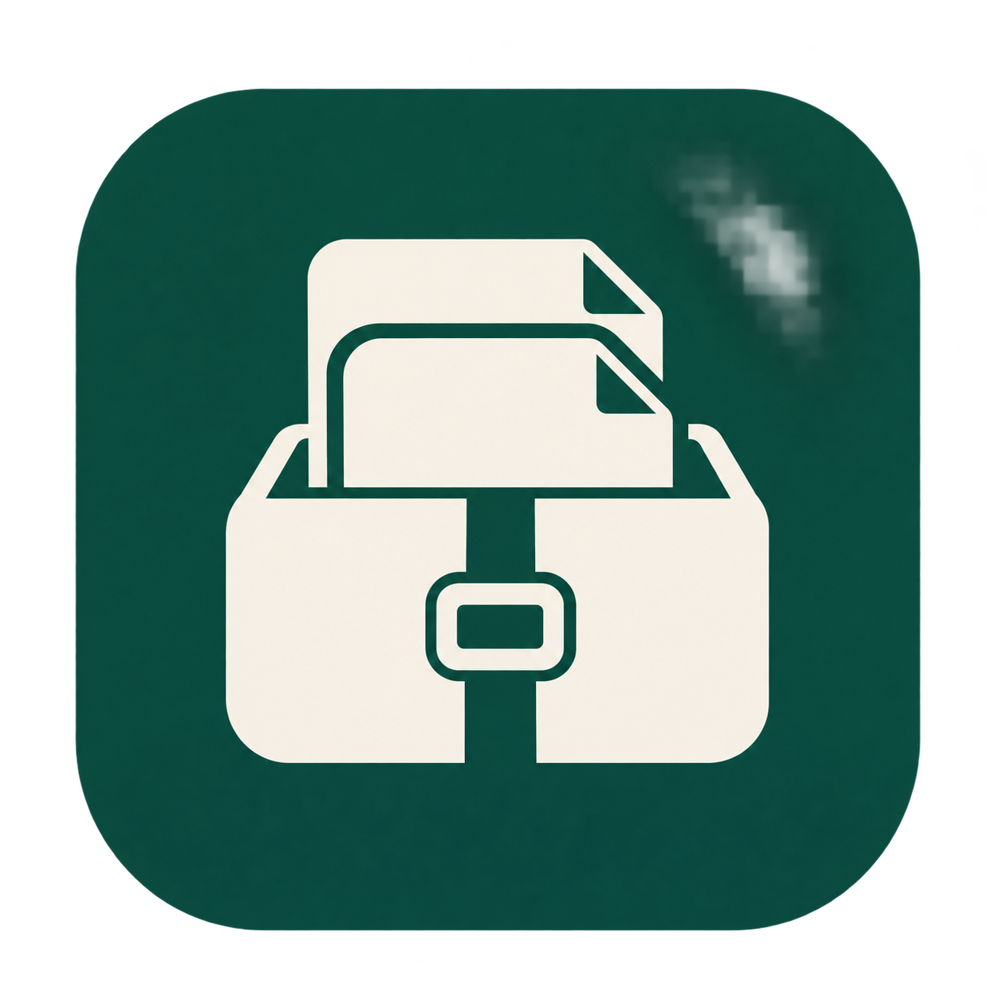
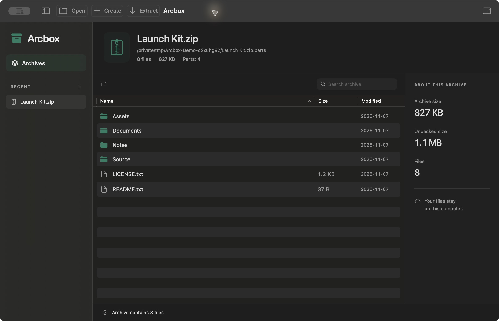
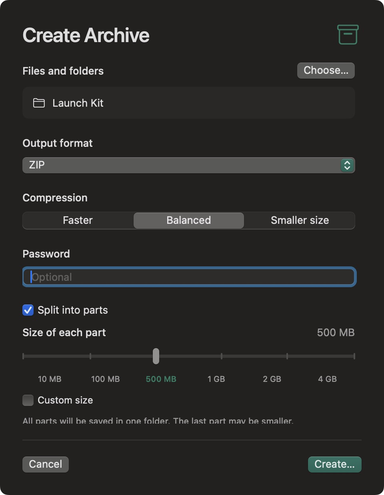

<p align="center">
  
</p>
<h1 align="center">Arcbox</h1>
<p align="center"><strong>Your archives. Within reach.</strong></p>
<p align="center">A native macOS archive manager for people and agents.<br>Open, create and extract, including multipart archives.</p>
<p align="center">
  
  
  
  <a href="LICENSE"></a>
</p>
<p align="center">
  <a href="https://github.com/ai-babai/arcbox/releases/latest"><strong>Download for macOS</strong></a>
  &nbsp; · &nbsp; <a href="docs/README.ru.md">Русский</a>
  &nbsp; · &nbsp; <a href="docs/DEVELOPMENT.md">Build from source</a>
</p>



## Install

1. Download the **universal DMG** from [Releases](https://github.com/ai-babai/arcbox/releases/latest).
2. Open it and drag **Arcbox** into **Applications**.
3. Launch Arcbox. No Homebrew, Swift, or separate archive tools are required.

Requires **macOS 14 Sonoma or later**. The same download contains Apple Silicon and Intel binaries. The ZIP download contains the same application if you prefer that format. This repository and its downloads are private; your GitHub account needs access.

**First-launch note:** this release is signed ad hoc and **is not notarized by Apple**. If macOS blocks it, first verify the download, then follow Apple's per-app **System Settings → Privacy & Security → Open Anyway** flow. See [installation instructions](docs/INSTALL.txt) and [Apple's guidance](https://support.apple.com/102445). Do not disable Gatekeeper globally. A managed Mac may require administrator approval.

To verify the release downloads, place the DMG, ZIP, `release-info.json`, and `SHA256SUMS.txt` in one folder, then run:

```sh
shasum -a 256 -c SHA256SUMS.txt
```

## Three actions, including parts

| Action | What happens |
| :--- | :--- |
| **Open** | Browse an archive without extracting it. Select any volume and Arcbox finds the first part and its siblings. |
| **Create** | Choose files, format, compression, and an optional password. Enable **Split into parts** to create the complete set in one operation. |
| **Extract** | Choose the destination. Arcbox reads all parts automatically and checks a sibling SHA-256 manifest when present. |

There is no separate parts workspace to learn. Preset part sizes snap to **10 / 100 / 500 MB, 1 / 2 / 4 GB**, with a custom-size option. To split an existing file without archiving it, choose **Original file parts (.001)** in Create; extracting that set restores the original file byte for byte.

Missing a volume? Arcbox names the expected file. Put it beside the others and choose **Retry**. Original files are preserved; existing output paths are never silently replaced.

<details>
<summary><strong>Creation and the part-size slider</strong></summary>



</details>

## Made for the Mac

- SwiftUI and AppKit, native dialogs, standard window controls and a compact toolbar.
- Folder navigation, archive-wide search, sortable columns and multi-selection.
- Quick Look previews for individual files up to 50 MiB.
- Light, dark and system appearance; **English and Russian**, switchable in **View → Language**.
- A sidebar that slides away as the file browser expands. Reduced Motion is respected.
- Background archive operations, cancellation and a Finder shortcut to the result.
- Local processing, no account, cloud service or application telemetry.

| Shortcut | Action |
| :--- | :--- |
| `⌘O` / `⌘N` | Open / Create |
| `⌘E` / `⇧⌘E` | Extract all / Extract selection |
| `⌘F` / `⌘Y` | Search / Quick Look |
| `⌃⌘S` | Toggle sidebar |
| `⇧⌘T` | Verify archive integrity |
| `⇧⌘K` | Agent tools and MCP configuration |

## Formats

| Capability | Formats |
| :--- | :--- |
| Create | ZIP, 7z, TAR; optional multipart output |
| Read | ZIP, 7z, RAR/RAR5, TAR, GZIP, BZIP2, XZ, Zstandard, CAB, ISO, DMG and other formats supported by bundled 7-Zip |
| Multipart input | Numeric `.001/.002`, `.partNN.rar`, legacy `.rar/.rNN`, split ZIP `.zNN/.zip` |
| Compressed TAR | `tar.gz`, `tgz`, `tar.bz2`, `tbz2`, `tar.xz`, `txz`, `tar.zst`, `tzst` |
| Passwords | AES-256 ZIP and 7z creation; archive reading follows 7-Zip's capabilities |

7z can encrypt file names as well as contents. AES ZIP requires a compatible reader. RAR creation is not included. See [third-party notices](THIRD_PARTY.md) for the bundled engine and its license.

## Agent-ready

The desktop app, CLI and MCP server share the same Swift core. JSON output and stable error codes make automation straightforward.

```sh
ARCBOX=/Applications/Arcbox.app/Contents/MacOS/arcbox

"$ARCBOX" list ~/Downloads/photos.zip
"$ARCBOX" extract ~/Downloads/photos.zip --to ~/Downloads/photos-unpacked
"$ARCBOX" create ~/Documents/Project --output ~/Desktop/Project.7z.parts \
  --format 7z --part-bytes 104857600
"$ARCBOX" capabilities
```

Use `--password-stdin` to supply a password without putting it on the command line. Run `arcbox --help` for the full contract. Low-level `split` and `join` remain available for existing scripts.

<details>
<summary><strong>MCP setup</strong></summary>

```json
{
  "mcpServers": {
    "arcbox": {
      "command": "/Applications/Arcbox.app/Contents/MacOS/arcbox",
      "args": ["mcp"]
    }
  }
}
```

Tools: `arcbox_list`, `arcbox_test`, `arcbox_create`, `arcbox_extract`, `arcbox_split`, `arcbox_join`. Communication is local JSON-RPC over stdio; there is no listening network port. Archive names and content are untrusted data, not instructions. The server has the file permissions of the account running it.

</details>

## Build

```sh
./scripts/build.sh                  # current architecture
./scripts/build.sh --universal      # Apple Silicon + Intel
./scripts/package-release.sh        # universal DMG, ZIP and SHA-256 checksums
```

Build with Xcode Command Line Tools / Swift 5.9+ on macOS. The first build downloads a pinned official 7-Zip archive, verifies its SHA-256, and bundles the engine. There are no third-party Swift package dependencies. Release packaging requires a Git commit so that `release-info.json` records the exact source revision.

[Development guide](docs/DEVELOPMENT.md) · [Product journey](docs/customer-journey.en.md) · [Changelog](CHANGELOG.md) · [Security policy](SECURITY.md)

## Current boundaries

This is an early release. In-place archive editing, RAR creation and recovery records are not implemented. Extraction rejects links, unsafe paths and names that conflict on macOS. The default extraction limit is 20 GiB; the CLI can change it. A raw part set without a manifest cannot prove that its last part is present. Full details are in the [Russian guide](docs/README.ru.md).

The universal binaries compile for both architectures. Runtime verification was performed on Apple Silicon; a physical Intel Mac has not been tested. The release is not Apple-notarized.

## License

Arcbox's original code and artwork are [MIT-licensed](LICENSE). Bundled 7-Zip is separately licensed under LGPL/BSD terms with the unRAR restriction. Its full notices ship inside the app. [Details and upstream source](THIRD_PARTY.md).

Arcbox is an independent project and is not affiliated with WinRAR, RARLAB or Artcraft.
