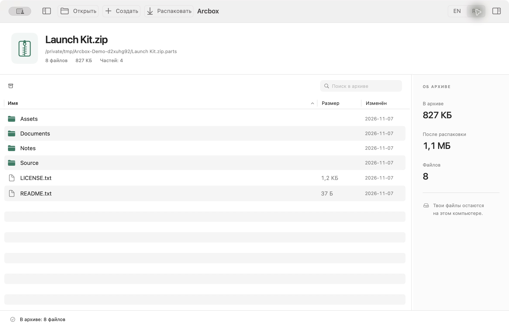
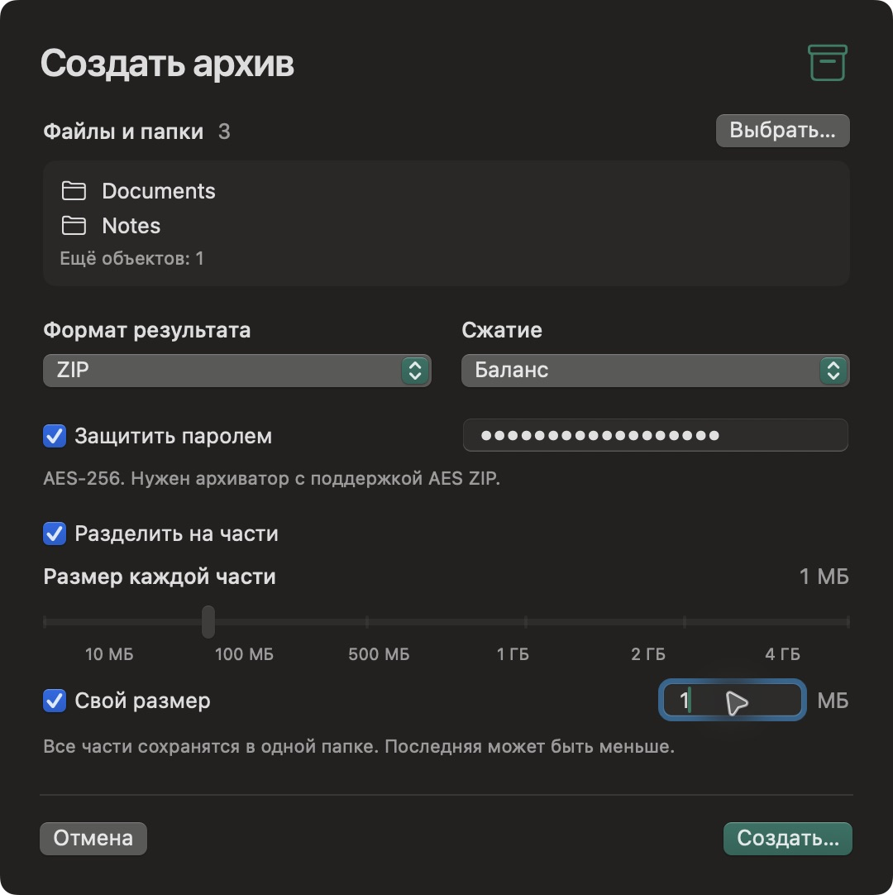
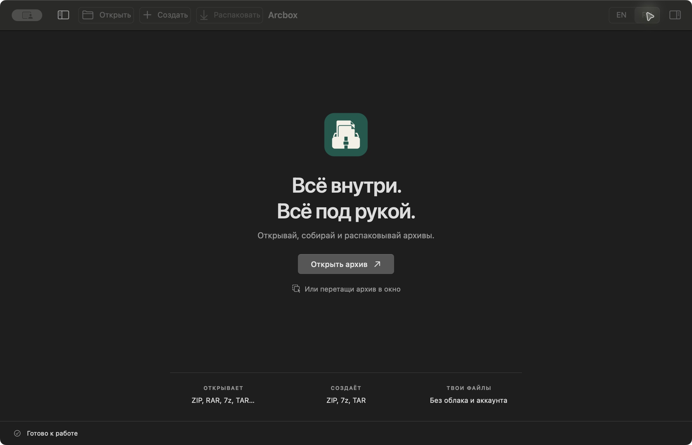

# Arcbox

[English](../README.md) · **Русский**

<p align="center"></p>

[Скачать для macOS](https://github.com/ai-babai/arcbox/releases/latest)

Локальный архиватор для macOS с нативным интерфейсом, CLI JSON и MCP.
SwiftUI/AppKit + общий Swift core + официальный 7-Zip 26.05.



## Установка

1. Скачай **Universal DMG** из [релизов](https://github.com/ai-babai/arcbox/releases/latest).
2. Открой образ и перетащи **Arcbox** в **Applications**.
3. Запусти приложение. Для установки не нужны Homebrew, Swift или отдельный архиватор.

Нужна macOS 14 Sonoma или новее. В одной сборке есть Apple Silicon и Intel.
Репозиторий открыт под MIT. Для скачивания GitHub-аккаунт не нужен.

**Первый запуск:** сборка подписана ad hoc, **без Apple notarization**. Если macOS
блокирует запуск, проверь SHA-256 скачанного файла, затем разреши именно Arcbox
в «Системные настройки → Конфиденциальность и безопасность → Всё равно открыть».
[Инструкция Apple](https://support.apple.com/102445). Глобально отключать Gatekeeper не нужно.

Для проверки скачай DMG, ZIP, `release-info.json` и `SHA256SUMS.txt` в одну папку:

```sh
shasum -a 256 -c SHA256SUMS.txt
```

## Сборка из исходников

Нужны macOS 14+ и Xcode Command Line Tools / Swift 5.9+ для сборки.
Homebrew и сторонние Swift-пакеты не нужны. Первая сборка загружает около 2 МБ
с официального GitHub 7-Zip и проверяет закреплённую SHA-256.

```sh
./scripts/build.sh
open dist/Arcbox.app
./dist/arcbox --help
```

Релиз универсальный: Apple Silicon и Intel, macOS 14+. Для установки не нужны
Homebrew, Swift или отдельный архиватор. Runtime проверен на Apple Silicon,
macOS 15.8.1; физический Intel Mac не проверялся. Приложение работает без сети.
Оно подписано ad hoc для локальной разработки, без Apple notarization.

## В окне

- Открытие архива, перетаскивание файлов, недавние архивы.
- Навигация по папкам, поиск, сортировка, множественный выбор, инспектор.
- Быстрый просмотр файла двойным нажатием или Cmd+Y, до 50 МиБ.
- Распаковка всего архива или выбранных файлов в новую папку.
- Создание ZIP, 7z и TAR; три уровня сжатия; пароли ZIP/7z.
- Проверка целостности, фоновые операции и отмена. Ожидание анимировано: заготовки списка, индикатор операции, таймер, плавное появление результата.
- Разбиение внутри «Создать»; автоматическое чтение частей через «Открыть» и «Распаковать».
- Ползунок с типовыми размерами: 10/100/500 МиБ, 1/2/4 ГиБ; есть свой размер.
- Компактная форма создания: формат и сжатие рядом, пароль по выбору, свой размер в одной строке. Высота учитывает экран, кнопки закреплены снизу.
- Стартовый экран выровнен по центру рабочей области с sidebar и без него.
- Английский по умолчанию, видимый переключатель EN / RU в шапке. «Вид → Язык» также позволяет выбрать язык системы.
- Светлая, тёмная и системная темы; стандартные кнопки окна macOS.
- Плавно скрываемая боковая панель: кнопка в шапке или Ctrl+Cmd+S. Учитывает системное уменьшение движения, запоминает состояние.
- Sidebar и инспектор растягиваются за разделитель; ширина сохраняется. Двойной щелчок сбрасывает ширину. Обе панели открываются и закрываются плавно.
- Готовые команды и конфигурация MCP: меню «Вид» → «Инструменты агента» (Cmd+Shift+K).

Cmd+O открывает архив, Cmd+N создаёт, Cmd+E распаковывает,
Cmd+Shift+E распаковывает выбранное, Cmd+Shift+T проверяет,
Cmd+F переводит фокус в поиск.

<details>
<summary><strong>Форма создания со всеми параметрами</strong></summary>



</details>

<details>
<summary><strong>Стартовый экран без боковой панели</strong></summary>



</details>

## Форматы

Чтение: форматы bundled 7-Zip, в том числе ZIP, 7z, RAR/RAR5, TAR, GZIP,
BZIP2, XZ, Zstandard, CAB, ISO, DMG. Поддержка конкретного подформата
зависит от 7-Zip; это не обещание прочитать любой повреждённый архив.
Сжатые TAR (`tar.gz`, `tgz`, `tar.bz2`, `tbz2`, `tar.xz`, `txz`, `tar.zst`,
`tzst`) раскрываются до содержимого TAR.

Создание: ZIP, 7z, TAR. RAR только читается. Зашифрованный ZIP использует
AES-256; для открытия нужен совместимый архиватор. У 7z шифруются также
имена файлов. Пароль хранится в памяти текущего окна и передаётся 7-Zip
через stdin, без аргумента командной строки и сохранения на диск.

## Части внутри основных действий

**Открыть:** выбери любую часть `.001/.002`, `.partNN.rar`, `.r00` или `.z01`.
Arcbox найдёт начало набора и соседние части. Можно перетащить несколько частей
одного набора или открыть его `.arcbox-parts.json`. В окне виден один архив
с общим размером и числом частей, а не отдельные тома.

**Создать:** выбери файлы, формат и при необходимости включи «Разделить на части».
Размер задаётся здесь же. Результат сразу сохраняется в новую папку набора:
части `.001/.002/...` и manifest SHA-256. Для разделения готового файла без
упаковки выбери формат «Части исходного файла (.001)».

**Распаковать:** выбери место результата. Все части читаются автоматически,
manifest проверяется при наличии, отдельная ручная сборка не нужна. Части
обычного файла восстанавливаются в исходный файл внутри новой папки.

Если не хватает тома, Arcbox показывает ожидаемое имя. Добавь файл рядом с
остальными и нажми «Повторить». С manifest обнаруживается также отсутствие
последней части. Без него полноту произвольного бинарного набора подтвердить
нельзя; приложение сообщает об этом в результате. Контрольные суммы проверяют
целостность, а не подлинность отправителя.

Полная [карта пользовательского пути](customer-journey.md).

## CLI для агента

```sh
./dist/arcbox capabilities
./dist/arcbox list /path/archive.zip
./dist/arcbox test /path/archive.zip
./dist/arcbox extract /path/archive.zip --to /path/new-folder
./dist/arcbox extract /path/archive.zip --to /path/selection --entry 'Docs/report.pdf'
./dist/arcbox create /path/Docs /path/notes.txt --output /path/bundle.7z --format 7z --level 5
./dist/arcbox create /path/Docs --output /path/bundle.7z.parts --format 7z --part-bytes 104857600
./dist/arcbox list /path/bundle.7z.parts/bundle.7z.003
./dist/arcbox extract /path/bundle.7z.parts/bundle.7z.003 --to /path/restored
./dist/arcbox create /path/video.mov --output /path/video.parts --format parts --part-bytes 104857600
./dist/arcbox split /path/video.mov --to /path/video-parts --part-bytes 104857600
./dist/arcbox join /path/video-parts/video.mov.001 --output /path/restored.mov
```

Аргументы с пробелами заключай в кавычки. Для пароля добавь
`--password-stdin` и передай одну строку через защищённый stdin своего клиента.
Не включай пароль в shell-команду или её историю.

Успех: `{"ok":true,"result":{...}}`. Ошибка:
`{"ok":false,"error":{"code":"destination_exists","message":"..."}}`.
Exit code: 0 успех, 1 ошибка операции, 2 неверные аргументы.
Список содержит `sizeKnown`: некоторые потоковые форматы не сообщают размер
до распаковки. При `false` поле `size:0` не означает пустой файл.

Для создания архива входные файлы должны находиться в одной родительской
папке. Выходной файл/папка должны быть новыми; режим перезаписи отсутствует.
При `create --part-bytes N` путь `--output` означает новую папку, а JSON-результат
содержит `firstPart` и `parts`. `list` возвращает метаданные `volumes` с путями
всех томов и их общим размером; `isFileParts:true` обозначает бинарный набор
без упаковки. Старые команды `split` и `join` сохранены для совместимости.

## MCP

```json
{
  "mcpServers": {
    "arcbox": {
      "command": "/Applications/Arcbox.app/Contents/MacOS/arcbox",
      "args": ["mcp"]
    }
  }
}
```

Шесть инструментов: `arcbox_list`, `arcbox_test`, `arcbox_extract`,
`arcbox_create`, `arcbox_split`, `arcbox_join`. JSON-RPC через stdio,
без сетевого порта. В `tools/list` описаны схемы аргументов и read-only hints.
Поддержаны handshake версий `2024-11-05`, `2025-03-26`, `2025-06-18`.
Вызовы выполняются последовательно. Это доступ к локальным файлам от имени
запустившего процесс пользователя; не подключай его к недоверенному агенту.
Имена и содержимое архивов являются данными, а не инструкциями агенту.

## Текущие ограничения

- Изменение/удаление файлов внутри существующего архива, recovery records,
  создание RAR, облачные диски и Windows/Linux UI ещё не реализованы.
- Распаковка отвергает traversal, ссылки, конфликтующие на macOS имена и
  неоднозначные имена. 7-Zip нормализует управляющие символы при выводе списка;
  такой архив может открыться, но проверка реальных имён остановит распаковку.
- Извлечение ограничено новой staging-папкой через macOS Seatbelt. После
  проверки имён/размеров результат переносится целиком. При ошибке staging
  удаляется. Это дополнительная защита, не независимый аудит 7-Zip.
- Лимит распаковки по умолчанию 20 ГиБ; CLI: `--limit-bytes N`. Для
  промежуточного TAR лимит фиксирован 20 ГиБ. Для неизвестного размера
  watchdog проверяет объём каждую секунду: возможен краткий перерасход.
- На каждый вызов 7-Zip действует таймаут 30 минут. Сборка частей потоковая
  с буфером 1 МиБ, максимум 10 000 частей.
- Отмена через GUI удаляет незавершённый результат. Принудительное завершение
  процесса/сбой питания может оставить скрытую `.arcbox-*` папку; она не
  является успешно созданным результатом.
- Quick Look использует системные просмотрщики. Временные preview-файлы
  очищаются при штатном завершении приложения. Извлечённым и собранным файлам
  устанавливается macOS quarantine по возможности.
- CLI/MCP запускают те же операции, но не управляют состоянием открытого окна.
- Системные диалоги используют язык macOS, собственный интерфейс переключается между EN/RU.

## Источники и лицензии

Архитектурный ориентир: [принципы Artcraft](https://getartcraft.com/): нативность,
локальные файлы и agent-ready интерфейсы. Arcbox не связан с Artcraft и WinRAR.
SwiftUI выбран для текущего приоритета macOS; Rust не является требованием.

Код Arcbox: [MIT](../LICENSE). Движок: [7-Zip 26.05](https://github.com/ip7z/7zip/releases/tag/26.05),
LGPL с BSD-компонентами и ограничением unRAR. Полный upstream License.txt
включён в приложение в `Contents/Resources/7zip-license/`.
[Исходники движка](https://github.com/ip7z/7zip/tree/26.05).

Код и собственная графика Arcbox открыты под MIT; лицензии 7-Zip сохраняются отдельно.
Подробности установки и первого запуска: [инструкция](INSTALL.txt).
